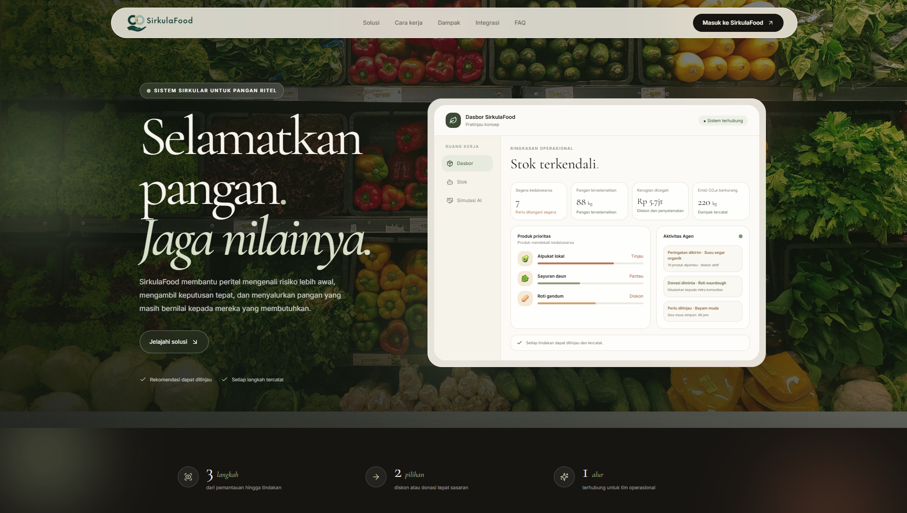
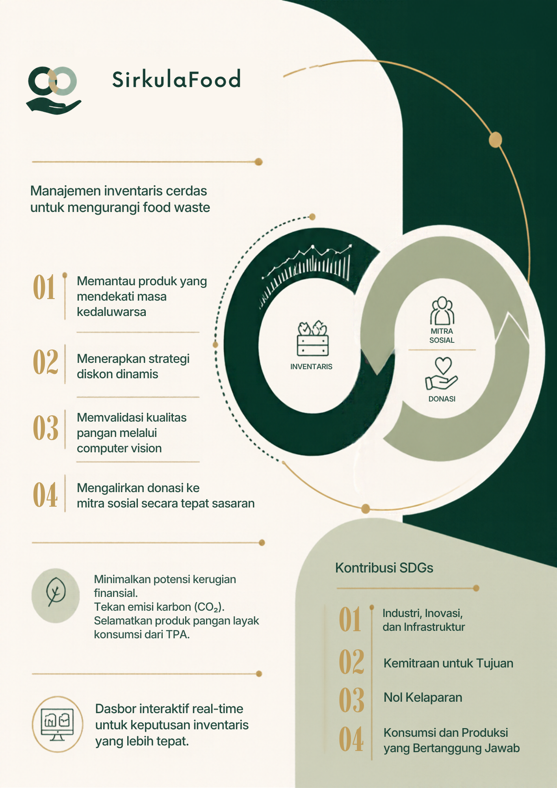

<div align="center">
  
  <h1>Selamatkan pangan, jaga nilainya.</h1>
  <p><strong>Manajemen inventaris cerdas untuk mengurangi limbah pangan.</strong></p>
  <p>SirkulaFood membantu tim ritel memantau produk mendekati kedaluwarsa, mengelola diskon, dan menyalurkan surplus pangan layak kepada mitra donasi.</p>
  <p>
    <a href="https://sirkulafood.my.id/">Kunjungi website</a> ·
    <a href="https://web.telegram.org/k/">Buka Telegram</a> ·
    <a href="https://github.com/SirkulaFood/SirkulaFood">Lihat kode sumber</a>
  </p>
</div>



## Tentang SirkulaFood

SirkulaFood adalah platform berbasis Laravel dan Vue untuk mengelola produk, batch inventaris, serta tanggal kedaluwarsa. Tim dapat meninjau produk berisiko, mempertimbangkan rekomendasi diskon, dan mengoordinasikan surplus pangan dengan mitra donasi. Setiap rekomendasi dan tindak lanjut dicatat agar dapat ditinjau kembali.

## Jenis akun

| Jenis akun | Kegunaan | Pendaftaran |
|:--|:--|:--|
| **Mitra sosial / yayasan** | Menerima produk yang didonasikan. | Tersedia pada halaman pendaftaran. |
| **Mitra UMKM** | Menerima informasi produk diskon. | Tersedia pada halaman pendaftaran. |
| **Supermarket / toko** | Mengelola inventaris serta menawarkan produk untuk diskon atau donasi. | Tersedia pada halaman pendaftaran. |
| **Admin sistem** | Mengelola platform dan akun mitra. | Dibuat oleh administrator. |

Pemilik toko dapat memberikan akses operasional kepada staf dengan peran pengelola atau kasir.

## Alur pengelolaan pangan

| Tahap | Dukungan SirkulaFood |
|:--|:--|
| **Pantau** | Tinjau produk, batch, jumlah stok, harga, dan sisa masa simpan. |
| **Periksa** | Gunakan analisis gambar sebagai bantuan awal untuk menilai kondisi produk. |
| **Pertahankan nilai** | Tinjau rekomendasi dan persetujuan diskon sebelum perubahan diterapkan. |
| **Salurkan** | Siapkan produk yang memenuhi syarat untuk mitra donasi dan koordinasikan serah terima. |
| **Catat** | Simpan aktivitas, keputusan, serta rekap untuk ditinjau. |

## Kontribusi terhadap SDGs

Melalui pemantauan inventaris, strategi diskon, pemeriksaan kondisi pangan, dan penyaluran donasi, SirkulaFood mendukung upaya menuju konsumsi dan produksi yang lebih bertanggung jawab, pengurangan kelaparan, inovasi operasional, dan kemitraan untuk mencapai tujuan bersama.

<p align="center">
  
</p>

Kontribusi tersebut menggambarkan dukungan melalui alur kerja dan kemitraan; bukan klaim pencapaian target SDGs secara keseluruhan. Pengukuran dampak membutuhkan data operasional dan tolok ukur yang jelas.

## Teknologi dan integrasi

| Teknologi | Peran |
|:--|:--|
| **Laravel 12** | Backend, inventaris, aturan bisnis, persetujuan, audit, dan API. |
| **Vue 3 + Inertia** | Dasbor, portal mitra, simulasi, dan alur kerja pengguna. |
| **9Router** | Gateway kompatibel OpenAI untuk model bahasa dan visi yang dikonfigurasi. |
| **Telegram** | Percakapan berbasis webhook dan tindak lanjut inventaris. Persetujuan tetap dilakukan oleh staf berwenang. |
| **n8n** | Berkas alur kerja tersedia sebagai draf nonaktif. Atur endpoint dan kredensial sebelum diimpor atau diaktifkan. |
| **MySQL / SQLite** | Penyimpanan aplikasi sesuai konfigurasi lokal. |

### Alur keputusan AI

```text
Data inventaris / foto produk
              ↓
Laravel memvalidasi konteks dan permintaan
              ↓
9Router → model AI yang dikonfigurasi → hasil terstruktur
              ↓
Staf meninjau / menyetujui melalui aplikasi atau Telegram
              ↓
Diskon atau donasi yang disetujui → dicatat oleh Laravel
```

Analisis AI membantu memberikan konteks, tetapi foto saja tidak dapat memastikan kesegaran, kontaminasi, bau, atau keamanan pangan. Staf tetap berwenang menentukan kelayakan dan keputusan operasional.

## Menjalankan secara lokal

### Persyaratan

- PHP 8.2 atau lebih baru dan Composer
- Node.js dan npm
- MySQL atau SQLite
- Ekstensi PHP yang dibutuhkan Laravel 12

### Instalasi

```powershell
git clone https://github.com/SirkulaFood/SirkulaFood.git
Set-Location SirkulaFood
composer install
npm install
Copy-Item .env.example .env
php artisan key:generate
```

Atur koneksi database di `.env`, lalu jalankan migrasi dan build aset frontend:

```powershell
php artisan migrate
npm run build
```

Untuk pengembangan lokal, jalankan layanan yang diperlukan pada terminal terpisah:

```powershell
php artisan serve
php artisan queue:listen --tries=1 --timeout=0
npm run dev
```

Atau gunakan skrip Composer yang tersedia:

```powershell
composer run dev
```

### Integrasi opsional

- **9Router:** Atur `NINEROUTER_API_KEY`, `NINEROUTER_BASE_URL`, `NINEROUTER_MODEL`, dan `NINEROUTER_VISION_MODEL`. Contoh URL dasar adalah `http://127.0.0.1:20128/v1`; proses Laravel harus dapat menjangkaunya.
- **Telegram:** Atur `TELEGRAM_BOT_TOKEN` dan `TELEGRAM_WEBHOOK_SECRET`, lalu daftarkan webhook HTTPS publik dengan `php artisan telegram:set-webhook --url=https://domain-anda.example`.
- **n8n:** Atur variabel webhook di `.env` sesuai kebutuhan. Alur kerja yang disertakan tidak aktif sebelum dikonfigurasi dan diaktifkan di lingkungan n8n.
- **Antrean dan penjadwal:** Konfigurasikan pekerja antrean serta penjadwal Laravel untuk notifikasi dan tugas terjadwal.

## Struktur proyek

```text
app/                    Backend Laravel, controller, model, layanan, dan job
resources/js/            Halaman Vue dan komponen antarmuka
resources/css/           Gaya aplikasi
routes/                  Rute web, API, dan tugas terjadwal
SirkulaFood-agent-*.json Ekspor alur kerja n8n
```

---

<div align="center">
  <sub>Kelola stok, tentukan langkah berikutnya, dan jaga keputusan tetap berada di tangan manusia.</sub>
</div>
