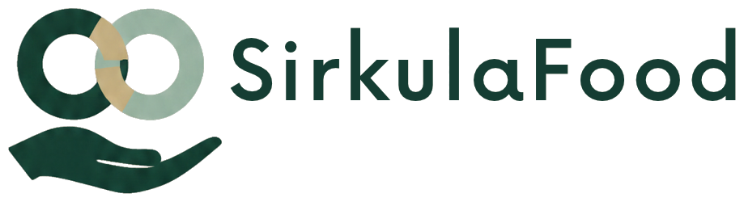

<div align="center">
  
  <h1>Selamatkan pangan, jaga nilainya.</h1>
  <p><strong>Manajemen inventaris cerdas untuk mengurangi limbah pangan.</strong></p>
  <p>SirkulaFood membantu tim ritel memantau produk mendekati kedaluwarsa, mengelola diskon, dan menyalurkan surplus pangan layak kepada mitra donasi.</p>
  <p><a href="https://sirkulafood.my.id/">Kunjungi website</a> · <a href="https://t.me/SirkulaFood_bot">Buka bot SirkulaFood</a> · <a href="https://github.com/SirkulaFood/SirkulaFood">Lihat kode sumber</a></p>
</div>

---

## About

SirkulaFood is a Laravel and Vue web platform for managing products, inventory batches, and expiration dates. Teams can review at-risk products, consider markdowns, and coordinate eligible surplus with donation partners. Recommendations and follow-up actions are recorded so decisions can be reviewed.

## Account types

| Account type | Purpose | Registration |
|:--|:--|:--|
| **Foundation / charity** | Receives donated products. | Available on the registration page. |
| **MSME partner (UMKM)** | Receives information about discounted products. | Available on the registration page. |
| **Supermarket / store** | Manages inventory and offers products for donation or discount. | Available on the registration page. |
| **System admin** | Administers the platform and partner accounts. | Provisioned internally. |

Store owners can grant operational access to staff through manager or cashier accounts.

## Product workflow

| Stage | What SirkulaFood supports |
|:--|:--|
| **Monitor** | Review products, batches, quantities, prices, and remaining shelf life. |
| **Assess** | Use image review as an initial aid. It is not a food-safety certification. |
| **Recover value** | Review discount recommendations and approval workflows before applying changes. |
| **Redirect** | Reserve eligible products for donation partners and coordinate handoffs. |
| **Record** | Keep activity, decisions, and summaries for review. |

## Teknologi dan integrasi

| Technology | Role |
|:--|:--|
| **Laravel 12** | Backend, inventory, business rules, approvals, audit trail, and APIs. |
| **Vue 3 + Inertia** | Dashboard, partner portal, simulation, and user workflows. |
| **9Router** | OpenAI-compatible gateway for configured language and vision models. Configure credentials and model settings per environment. |
| **Telegram** | Bot untuk mengambil ID obrolan, percakapan chatbot berbasis AI, notifikasi inventaris, serta persetujuan tindakan oleh staf berwenang. |
| **n8n** | Workflow exports are included as inactive drafts. Configure endpoints and credentials in the deployment environment before importing or activating them. |
| **MySQL / SQLite** | Application storage, depending on local configuration. |

### Alur chatbot dan ID Telegram

Bot SirkulaFood dapat memberikan ID obrolan yang dipakai untuk menghubungkan akun aplikasi, mengirim pemberitahuan, dan membuka percakapan chatbot sesuai peran akun.

1. Buka [@SirkulaFood_bot](https://t.me/SirkulaFood_bot) lalu tekan **Mulai** atau kirim `/start` (perintah `/id` juga menampilkan ID).
2. Bot membalas dengan ID obrolan Telegram Anda. Salin ID tersebut ke kolom **ID Obrolan Telegram** saat mendaftar. Jika akun sudah terdaftar, pemilik bisnis, manager, atau kasir dapat mengaturnya di **Pengaturan → Profil**.
3. Setelah ID tersimpan di akun, kirim pertanyaan langsung ke bot. Chatbot hanya dapat membaca data dan menawarkan tindakan sesuai peran serta akun yang terhubung. Gunakan `/help` untuk panduan dan `/reset` untuk memulai ulang konteks percakapan.
4. Permintaan seperti diskon, donasi, atau perubahan otomatisasi perlu dikonfirmasi oleh pengguna berwenang melalui tombol Telegram sebelum diproses. Bot juga dapat mengirim notifikasi dan meminta persetujuan operasional.

Untuk mengaktifkan bot pada server, isi `TELEGRAM_BOT_TOKEN` dan `TELEGRAM_WEBHOOK_SECRET` di `.env`. Atur `NINEROUTER_API_KEY` beserta URL dan model yang sesuai untuk fitur chatbot AI. Pastikan aplikasi dapat diakses melalui HTTPS publik, lalu daftarkan webhook:

```bash
php artisan telegram:set-webhook --url=https://domain-anda.example
```

Webhook menerima pembaruan di `/api/v1/telegram/webhook`. Tanpa token bot, webhook HTTPS yang aktif, dan kunci AI, alur chat serta balasan AI tidak dapat berjalan penuh. Untuk mengambil ID obrolan melalui bot, webhook Telegram harus sudah aktif.

### Alur keputusan AI

```text
Data inventaris / foto produk
              ↓
Laravel memvalidasi konteks dan permintaan
              ↓
9Router → model AI yang dikonfigurasi → hasil terstruktur
              ↓
Staf meninjau / menyetujui melalui aplikasi atau Telegram
              ↓
Diskon atau donasi yang disetujui → dicatat oleh Laravel
```

AI dapat membantu memberikan konteks, tetapi foto saja tidak dapat memastikan kesegaran, kontaminasi, bau, atau keamanan pangan. Staf tetap berwenang menentukan kelayakan dan keputusan operasional.

## Run locally

### Prerequisites

- PHP 8.2 or newer and Composer
- Node.js and npm
- MySQL or SQLite
- PHP extensions required by Laravel 12

### Installation

```bash
git clone https://github.com/SirkulaFood/SirkulaFood.git
cd SirkulaFood
composer install
npm install
cp .env.example .env
php artisan key:generate
```

Set up the database connection in `.env`, then run migrations and build the frontend assets:

```bash
php artisan migrate
npm run build
```

For local development, run the required services in separate terminals:

```bash
php artisan serve
php artisan queue:listen --tries=1 --timeout=0
npm run dev
```

Or use the available Composer script:

```bash
composer run dev
```

### Optional integrations

- **9Router:** Set `NINEROUTER_API_KEY`, `NINEROUTER_BASE_URL`, `NINEROUTER_MODEL`, and `NINEROUTER_VISION_MODEL`. The example base URL is `http://127.0.0.1:20128/v1`; it must be reachable from the Laravel process.
- **Telegram:** Atur `TELEGRAM_BOT_TOKEN`, `TELEGRAM_WEBHOOK_SECRET`, dan konfigurasi 9Router untuk chatbot. Bot memerlukan webhook HTTPS publik; lihat [Alur chatbot dan ID Telegram](#alur-chatbot-dan-id-telegram) untuk langkah pendaftaran webhook dan penggunaan.
- **n8n:** Set the webhook variables in `.env.example` as needed. The workflow exports in this repository are inactive until configured and enabled in your n8n environment.
- **Queue and scheduler:** Configure a queue worker and Laravel scheduler in the deployment environment for notifications and scheduled jobs.

## Project structure

```text
app/                   Laravel backend, controllers, models, services, and jobs
resources/js/           Vue pages and interface components
resources/css/          Application styles
routes/                 Web routes, API routes, and scheduled tasks
SirkulaFood-agent-*.json n8n workflow exports
```

## Impact

SirkulaFood aims to help reduce avoidable food waste and recover value from inventory. Any claims about waste or emissions reductions require a baseline and measured operational data.

---

<div align="center">
  <sub>Built with a circular mindset: review the stock, coordinate the next step, and keep people in control.</sub>
</div>
